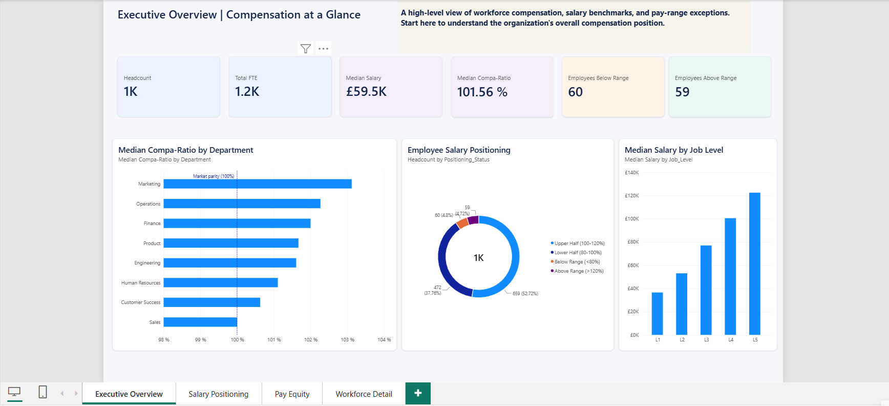
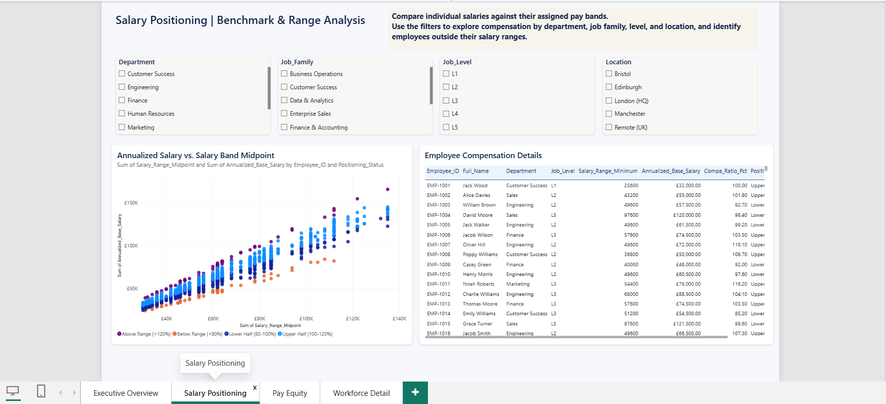
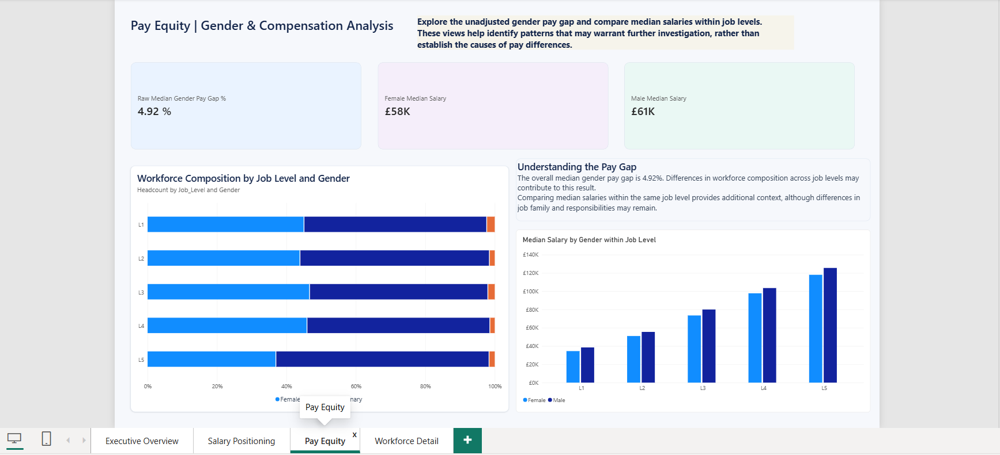
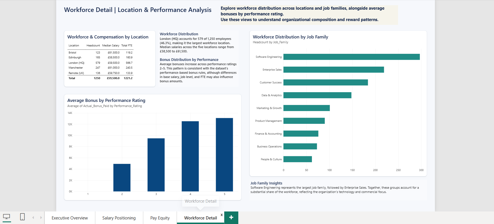

# Compensation Benchmarking & Pay Analysis
### 119 employees are outside their salary bands. Who are they, and why?

That's the question at the heart of this project.

I wanted to build something that went beyond displaying average salaries. Something that could help a compensation analyst investigate pay decisions, spot exceptions, and ask better questions about fairness.

So I created a fictional UK technology company, modeled its compensation structure in Python, analyzed the data with SQL, and built a four-page interactive Power BI report.

**1,250 employees · 45 salary bands · 9 job families · 5 job levels**

## 👀 Take a Look

### The big picture

*An executive view of salary benchmarks, workforce compensation, and pay-range exceptions.*

### Who's outside their pay band?

*Compare individual salaries against benchmarks and investigate differences by department, job family, level, and location.*

### What does the gender pay gap actually tell us?

*An unadjusted gender pay gap is only the beginning. This page adds workforce composition and job-level salary comparisons.*

### Where does everyone work, and how are bonuses distributed?

*Explore the workforce by location and job family, alongside performance-related bonuses.*

## 🔍 A Few Things Worth Noticing

| Finding | Result |
|---|---:|
| Median annualized salary | **£59,500** |
| Median compa-ratio | **101.56%** |
| Employees outside salary bands | **119 (9.5%)** |
| Unadjusted median gender pay gap | **4.92%** |
| Employees based in London | **46.3%** |

The interesting part is what happens after finding these numbers. Which employees need a closer salary review? Are pay differences consistent across job levels? And how do compensation patterns change when you filter the workforce?

That's what the report is designed to explore.

## 🛠️ What I Built (Beyond the Charts)

**Python — I built the dataset instead of downloading one.**

A reproducible generator models 1,250 employee records and 45 salary bands, incorporating job levels, locations, FTE arrangements, salary variation, and performance-related bonuses.

**Compensation logic — I made the comparisons meaningful.**

FTE-normalized salaries, compa-ratios, salary-band exceptions, and gender pay comparisons give the analysis more structure than simply calculating averages.

**SQL — I investigated the exceptions.**

Analytical queries compare compensation across employee groups, identify employees outside their bands, and calculate how far salaries fall beyond the relevant boundaries.

**Power BI & DAX — I brought the analysis together.**

Four interactive report pages combine executive KPIs, salary benchmarks, employee-level exploration, and workforce analysis.

`Python → SQL analysis + Power BI modeling → DAX measures → Interactive report`

## 🖱️ Explore It Yourself

**[Open the Power BI report (.pbix)](powerbi/compensation-benchmarking-dashboard.pbix)**

Download and open it using the free Power BI Desktop application to explore the pages and interact with the filters.

For a closer look at the implementation: [Python generator](src/generate_data.py) · [SQL queries](sql/compensation_analysis.sql) · [Methodology](docs/methodology.md) · [Data dictionary](docs/data_dictionary.md)

---

*Built as a portfolio project using simulated employee data and modeled salary benchmarks. Findings describe the fictional scenario, not a real employer. Pay-gap comparisons are descriptive and do not establish causation.*
